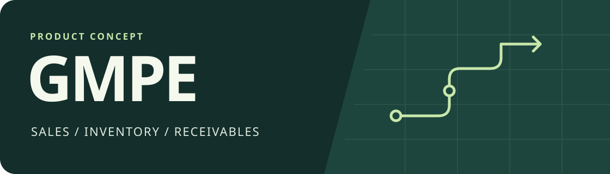
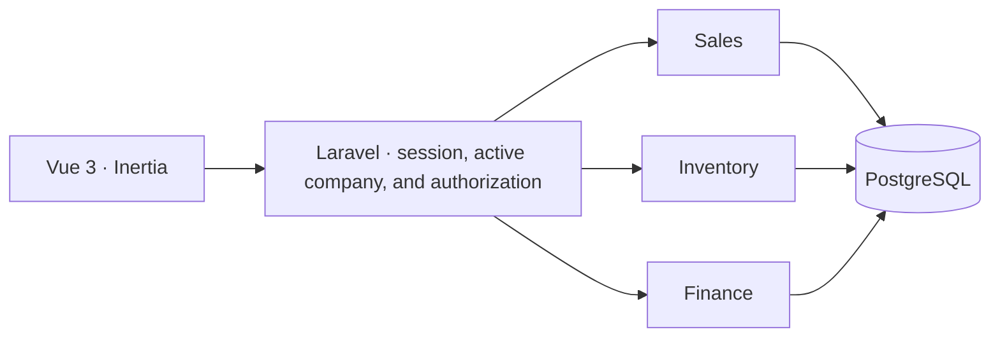

# GMPE

[Português](README.md) · **English**

**Management for Micro and Small Businesses.** GMPE is a product concept for small retailers that sell physical goods and receive some payments after the sale. The first release aims to link each sale to inventory, cash received, and the remaining balance.

**Project status:** planning. This repository contains the product and architecture proposal. The application and demo are planned deliverables.

## The problem

One sale can reduce inventory today, put part of the money in the till, and leave the rest due later. When those records are kept separately, it is hard to tell what was received, what remains due, and which sale each amount belongs to. Stock discrepancies also surface at the counter when two people try to sell the last unit.

The initial audience is small shops with an owner and sales staff. GMPE is **multi-tenant from the start**. Each company has its own memberships, catalog, inventory, sales, and receivables. Staff can create and confirm sales within their permissions. The owner follows inventory, cash, and receivables, and reviews adjustments.

## The demo we want to build

1. Open a fictional shop as a sales clerk. Confirm a **BRL 300** sale with **BRL 100** paid up front.
2. Check the stock movement, the BRL 100 cash entry, and the **BRL 200 receivable**, all linked to the same sale.
3. Record the remaining payment as the owner. The outstanding balance reaches zero and the history shows both payments.
4. In two sessions, try to sell the last unit. One sale is confirmed. The other receives an insufficient-stock message.

The demo will use synthetic data. This workflow is the acceptance criterion for the first release.

## Proposed architecture

| Decision | Rationale |
| --- | --- |
| **Laravel 13 + PHP 8.4 as a modular monolith** | Sales, inventory, and finance have separate responsibilities within one application. Confirmation can record their effects in one transaction, with one deployment for the first release. |
| **Vue 3 + TypeScript + Inertia** | The sales interface needs responsive search, filters, and changes to the order. Inertia connects those screens to Laravel routing and authentication. |
| **PostgreSQL** | Transactions, constraints, and per-item locks protect inventory and financial records. Amounts are stored in cents. Movements linked to a sale explain how balances changed. |
| **Pest, Playwright, and GitHub Actions** | Pest checks business rules and company access. Playwright exercises the browser workflow. CI runs those checks before publishing. |

### Environment and infrastructure

The local setup uses PHP, Node.js, and PostgreSQL installed directly. The demo uses managed hosting and PostgreSQL. A PostgreSQL transaction keeps sales, stock, and cash consistent.

### Tenant isolation

The model uses `companies` and user memberships with a role per company. Laravel resolves the active company from a valid authenticated membership. Policies and queries apply that context to each operation. Operational records carry a `company_id`; composite keys in critical relationships prevent cases such as a payment referencing a sale from another company.

The demo will have **two fictional shops** with separate data. In addition to the sale workflow, a test will try to read and update the other shop's records using a known identifier and verify that access is denied.

## Rules the tests must verify

- **Atomic sale confirmation.** Confirmation writes the order, inventory movements, and financial entries in one transaction. A failed step rolls back the writes from that attempt.
- **Concurrency-safe inventory.** Confirmation locks the stock rows in a stable order before checking availability. Retrying the same confirmation returns the previous result without decrementing stock again.
- **Receipts separate from sales.** Cash reflects what was actually received. Deferred amounts remain linked to the sale with a due date and open balance. Partial payments remain in the history.
- **Company and role boundaries.** Sessions from different companies cannot read or change each other's sales, inventory, or receivables. Financial operations require explicit authorization.
- **Traceable corrections.** Cancellations and reversals should record who made the change and link back to the original entry.

## AI-assisted development

AI helps shorten the path from understanding a rule to delivering a change that can be verified. The team owns product decisions and approves the changes.

| Stage | How AI helps | Verification |
| --- | --- | --- |
| **Understand** | Turn the shop's need into examples and suggest edge cases the team may have missed. | Confirm the workflow, permissions, and acceptance criteria with the team. |
| **Implement** | Help with small changes, tests, and decision documentation. | Review the diff and reproduce the cases in PostgreSQL or the browser. |
| **Review** | Look for race conditions, cross-tenant data leaks, retry failures, and missing tests. | Verify each finding against the code, run CI, and record the decision in the PR. |

**Example:** for the last unit in stock, AI can suggest a test in which two sessions confirm a purchase at the same time. The team verifies that the test really runs concurrent operations in PostgreSQL, proves that exactly one sale was recorded, and checks that cash reflects only that sale.

Pull requests record the rule, what AI helped produce, and how the team validated the result. Examples shared with AI tools use synthetic data, with credentials and customer data kept out of context.

## Delivery order

| Stage | Verifiable deliverable |
| --- | --- |
| **1. Foundation** | Authentication, company, roles, and an initial-stock catalog. Documented local setup and CI with PostgreSQL. |
| **2. Core workflow** | Confirmed sales, stock movements, cash entries, receivables, and partial payments. Concurrency and isolation tests. |
| **3. Published demo** | A dedicated environment with synthetic data, a guided walkthrough, browser tests, and PT/EN documentation. Links from the portfolio to the demo and case study. |

## Planned deployment

The first choice is **Laravel Cloud with managed Postgres** in a dedicated demo environment. The build compiles the Vue assets and deployment applies migrations. Demo seeding is separate from migrations. Publishing includes a health check, synthetic data, and a repeatable walkthrough. The Starter plan is usage-based, so application and database costs will be estimated together before deployment. [Deployment guide](https://laravel.com/cloud/docs/quickstart) · [Pricing](https://marketing.cloud.laravel.com/pricing)

## Portfolio readiness

The case study will start with the shop's problem, show the workflow running, and link each technical decision to its implementation or a test. Diagrams will be labeled as illustrations, and screenshots will come from the published demo. The project is ready to be featured once the walkthrough can be repeated end to end.
