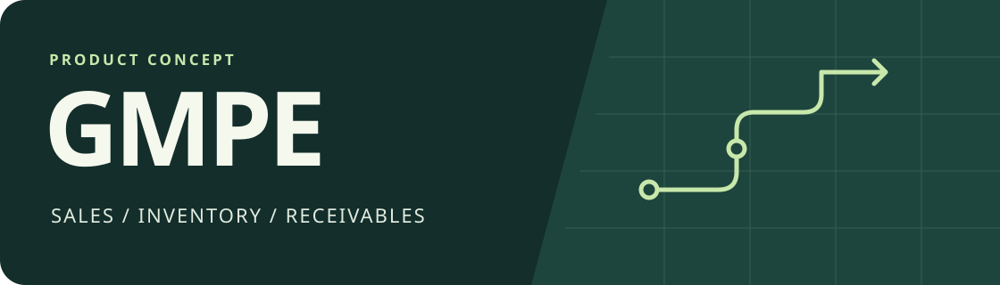
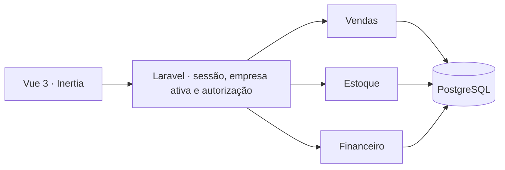

# GMPE

**Português** · [English](README.en.md)

[](https://github.com/acamilateixeira/gmpe/actions/workflows/ci.yml)

**Gestão de Micro e Pequenas Empresas.** O GMPE é uma proposta de produto para pequenas lojas que vendem mercadorias e recebem parte das vendas a prazo. A primeira versão pretende conectar cada venda ao estoque, ao caixa e ao que ainda falta receber.

**Estado do projeto:** demo local da regra de venda e arquitetura proposta para o produto.

## Rodar a demo de venda

Use PHP 8.4 com PDO SQLite. Em um terminal, inicie a API local com banco temporário.

```bash
GMPE_DEMO_DB="$(mktemp)" php -S 127.0.0.1:4301 demo/router.php
```

Em outro terminal, rode `php demo/test.php` ou importe a [coleção Postman](docs/postman.collection.json) no Postman ou Insomnia. Use um banco novo para cada execução da sequência. Ela confirma uma venda de R$ 300 com R$ 100 recebidos, verifica a repetição do pedido, recusa outra venda sem estoque e confere que a segunda loja ficou intacta. A demo usa duas lojas fictícias, chaves locais e PHP/SQLite. A aplicação Laravel, as sessões de usuário e a verificação de concorrência em PostgreSQL pertencem à arquitetura proposta.

## O problema

Uma venda pode baixar mercadoria do estoque hoje, colocar só uma parte do dinheiro no caixa e deixar o restante para outro dia. Quando cada informação fica em um lugar, é difícil responder quanto entrou, quanto ainda falta receber e de qual venda veio cada valor. Um erro no estoque também aparece no balcão quando duas pessoas tentam vender a mesma última unidade.

O público inicial são pequenas lojas com uma dona e atendentes. O GMPE nasce **multi-tenant**. Cada empresa tem seus próprios usuários vinculados, catálogo, estoque, vendas e recebimentos. A atendente cadastra e confirma vendas dentro das permissões. A dona acompanha estoque, caixa e recebimentos e revisa ajustes.

## A demo que queremos construir

1. Abra uma loja fictícia como atendente. Confirme uma venda de **R$ 300**, com **R$ 100** recebidos no ato.
2. Confira a saída da mercadoria, a entrada de R$ 100 no caixa e os **R$ 200 a receber**, vinculados à mesma venda.
3. Registre o pagamento restante como dona. O saldo em aberto chega a zero e o histórico mostra as duas entradas.
4. Em duas sessões, tente confirmar vendas da última unidade. Uma venda é confirmada. A outra recebe uma mensagem de estoque insuficiente.

Os dados da demo serão fictícios. O roteiro serve como critério de aceitação da primeira entrega.

## Arquitetura proposta



| Decisão | Por que usar |
| --- | --- |
| **Laravel 13 + PHP 8.4, em um monólito modular** | Vendas, estoque e financeiro têm responsabilidades próprias e usam a mesma aplicação. A confirmação pode gravar seus efeitos em uma transação, com um único deploy para a primeira versão. |
| **Vue 3 + TypeScript + Inertia** | A interface de venda precisa responder bem a buscas, filtros e mudanças no pedido. O Inertia conecta essas telas às rotas e à autenticação do Laravel. |
| **PostgreSQL** | Transações, constraints e locks por item protegem o estoque e os registros financeiros. Os valores são guardados em centavos. Movimentações vinculadas à venda permitem explicar de onde veio cada saldo. |
| **Pest, Playwright e GitHub Actions** | Pest verifica regras de negócio e acesso por empresa. Playwright cobre o fluxo no navegador. O CI executa as verificações antes da publicação. |

### Ambiente e infraestrutura

O ambiente local usa PHP, Node.js e PostgreSQL instalados diretamente. A demo usa hospedagem gerenciada e PostgreSQL. A transação no PostgreSQL garante a consistência de venda, estoque e caixa.

### Isolamento entre empresas

O modelo usa `companies` e vínculos de usuário por empresa, com o papel definido em cada vínculo. O Laravel resolve a empresa ativa a partir de um vínculo autenticado e válido. Policies e consultas aplicam esse contexto em cada operação. Os registros operacionais carregam `company_id`; chaves compostas nas relações críticas evitam vincular, por exemplo, um pagamento à venda de outra empresa.

A demo terá **duas lojas fictícias**, com dados separados. Além do fluxo de venda, o teste tentará consultar e alterar dados da outra loja usando um identificador conhecido e verificará a recusa.

## Regras que precisam passar nos testes

- **Venda atômica.** Confirmar a venda grava o pedido, as saídas de estoque e os lançamentos financeiros na mesma transação. Se uma etapa falhar, os registros daquela tentativa são revertidos.
- **Estoque protegido contra concorrência.** O estoque é conferido com lock nas linhas dos itens, em ordem estável. Repetir a mesma confirmação deve retornar o resultado anterior sem baixar o estoque duas vezes.
- **Recebimento separado da venda.** Só o valor efetivamente recebido entra no caixa. Valores a prazo ficam vinculados à venda, com vencimento e saldo em aberto. Pagamentos parciais ficam no histórico.
- **Acesso por empresa e por função.** Sessões de empresas diferentes não leem nem alteram vendas, estoque ou recebimentos umas das outras. Operações financeiras têm autorização explícita.
- **Correções rastreáveis.** Cancelamento e estorno devem deixar registros vinculados ao lançamento de origem, com identificação de quem fez a operação.

## Desenvolvimento assistido por IA

A IA entra no fluxo para reduzir o tempo entre entender uma regra e entregar uma mudança verificável. A decisão de produto e a aprovação da mudança ficam com a equipe.

| Etapa | Uso da IA | Como conferir |
| --- | --- | --- |
| **Entender** | Transformar a necessidade da loja em exemplos e sugerir situações que ainda não foram discutidas. | A equipe confirma o fluxo, as permissões e os critérios de aceitação. |
| **Implementar** | Ajudar em mudanças pequenas, na escrita de testes e na documentação da decisão. | Revisar o diff e reproduzir os casos em PostgreSQL ou no navegador. |
| **Revisar** | Procurar condições de corrida, vazamento entre empresas, falhas em reenvios e testes ausentes. | Conferir cada apontamento no código, rodar o CI e registrar a decisão no PR. |

**Exemplo:** para a última unidade em estoque, a IA pode sugerir um teste com duas sessões tentando confirmar a compra. A equipe verifica se o teste realmente executa operações concorrentes em PostgreSQL, comprova que só uma venda foi gravada e confere que o caixa reflete apenas aquela venda.

Os PRs registram a regra, o que a IA ajudou a produzir e como a equipe validou o resultado. Exemplos compartilhados com ferramentas de IA usam dados fictícios, com credenciais e dados de clientes fora do contexto.

## Ordem de entrega

| Etapa | Entrega verificável |
| --- | --- |
| **1. Base** | Autenticação, empresa, papéis e catálogo com estoque inicial. Ambiente local documentado e CI com PostgreSQL. |
| **2. Fluxo principal** | Venda confirmada, movimentação de estoque, entrada no caixa, saldo a receber e registro de pagamento parcial. Testes de concorrência e isolamento. |
| **3. Demo publicada** | Ambiente próprio com dados fictícios, roteiro guiado, teste de navegador e documentação em PT e EN. Link para a demo e para o estudo de caso no portfólio. |

## Publicação planejada

A primeira opção é **Laravel Cloud com Postgres gerenciado**, em um ambiente separado para a demo. O build prepara os assets do Vue e o deploy aplica migrations. O seed de demonstração fica separado das migrations. A publicação inclui verificação de saúde, dados fictícios e um percurso fácil de repetir. O plano Starter é cobrado por uso, então o custo de aplicação e banco entra na decisão antes de publicar. [Guia de deploy](https://laravel.com/cloud/docs/quickstart) · [Preços](https://marketing.cloud.laravel.com/pricing)

## Como o caso vai entrar no portfólio

O estudo começa pelo problema da loja, mostra o fluxo funcionando e liga cada decisão a um teste ou ao código que a implementa. Diagramas serão identificados como ilustrações e capturas virão da demo publicada. O projeto estará pronto para entrar em destaque quando o roteiro acima puder ser repetido de ponta a ponta.
